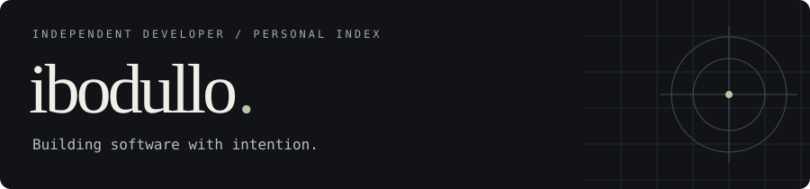

Student, independent developer, and systems enthusiast. Interested in the intersection of computer science, software architecture, and thoughtful design.

### 01 / Currently building

| Project | Description |
| :--- | :--- |
| **[Control](https://control.ibodullo.dev)** | A unified system for planning, focusing, and executing. |
| **Spazio** | A native workspace for organizing life and knowledge. |
| **Inside** | A personal publishing system centered around privacy and ownership. |

### 02 / Exploring

Computer science · Systems engineering · Artificial intelligence · Human-computer interaction

---

*Less friction. More intention.*

[**ibodullo.dev**](https://ibodullo.dev)
