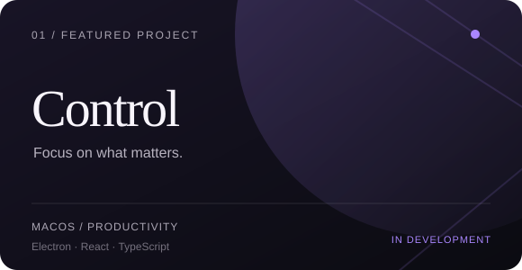
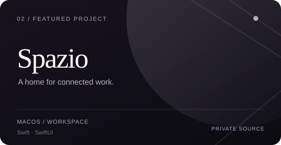

 

INDEPENDENT DEVELOPER &nbsp; / &nbsp; MACOS & WEB

  

[**Explore work**](#selected-work) &nbsp;&nbsp; [**Repositories**](https://github.com/ibodullosafarovv?tab=repositories) &nbsp;&nbsp; [**Activity**](https://github.com/ibodullosafarovv?tab=overview)

 

## Selected work

  
  

**[Control](https://github.com/ibodullosafarovv/Control)** is a macOS focus and planning app. **Spazio** is a native SwiftUI workspace connecting projects, notes, tasks, and resources. Both are in development; Spazio's source remains private.

### Other explorations

Atlas *(private)* &nbsp;·&nbsp; Personal API *(private)* &nbsp;·&nbsp; Software engineering research

### About

I care about the intersection of product design, system reliability, and the details that make software feel effortless.

**Working with:** Swift, SwiftUI, TypeScript, React, Electron, Python, Git.

---

Less friction. More intention.

