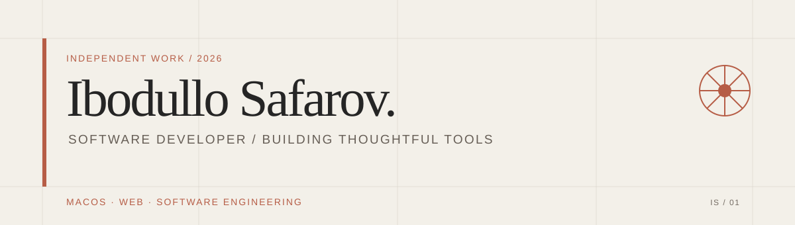

 

**Independent developer · macOS & web**

I build focused, intuitive software with an emphasis on thoughtful interfaces and reliable engineering.

[Projects](#selected-work) &nbsp;·&nbsp; [GitHub activity](https://github.com/ibodullosafarovv?tab=overview) &nbsp;·&nbsp; [Repositories](https://github.com/ibodullosafarovv?tab=repositories)

 

### Selected work

| Project | What it does | Stack |
| :--- | :--- | :--- |
| **[Control](https://github.com/ibodullosafarovv/Control)** | Focus sessions, planning, and distraction management for macOS. *In development.* | Electron · React · TypeScript |
| **Spazio** | A native macOS workspace connecting projects, tasks, notes, and resources. *In development; source private.* | Swift · SwiftUI |
| **[Atlas](https://github.com/ibodullosafarovv/atlas)** | Experiments in visual organization and connected ideas. | Web |
| **[Personal API](https://github.com/ibodullosafarovv/self-personal-api)** | Exploring a personal interface for sharing selected information and availability. | Web |

### About

I'm interested in the intersection of **product design**, **software engineering**, and **the small details that make tools feel effortless**.

Currently working on Control and Spazio, while researching how software systems can be made more dependable.

### Technologies

`Swift` · `SwiftUI` · `TypeScript` · `React` · `Electron` · `Python` · `Git`

 

---

Less friction. More intention.

